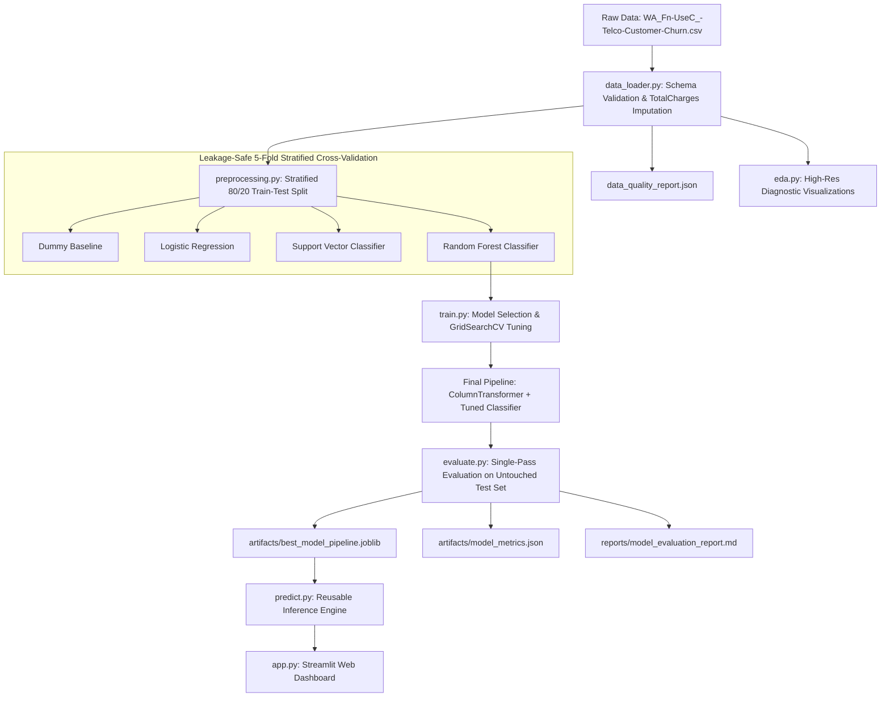

# Customer Churn Intelligence — ML Prediction & Retention Analytics

An end-to-end Machine Learning system that predicts customer subscription churn, uncovers empirical churn drivers, provides local risk explanations, and delivers actionable retention insights through an interactive Streamlit web dashboard.

Built using the authentic **IBM Telco Customer Churn** dataset from Kaggle.

---

## 📋 Table of Contents
- [Project Overview](#project-overview)
- [Problem Statement & Business Objectives](#problem-statement--business-objectives)
- [Dataset & Data Governance](#dataset--data-governance)
- [System Architecture](#system-architecture)
- [Project Structure](#project-structure)
- [Installation & Quickstart](#installation--quickstart)
  - [Windows (PowerShell)](#windows-powershell)
  - [macOS / Linux (Bash / Zsh)](#macos--linux-bash--zsh)
- [Dataset Setup](#dataset-setup)
- [Model Training & Benchmarking](#model-training--benchmarking)
- [Genuine Measured Performance](#genuine-measured-performance)
  - [5-Fold Stratified Cross-Validation Benchmark](#5-fold-stratified-cross-validation-benchmark)
  - [Final Evaluation on Held-Out Test Set](#final-evaluation-on-held-out-test-set)
  - [Diagnostic Evaluation Figures](#diagnostic-evaluation-figures)
- [Explainability & Risk Drivers](#explainability--risk-drivers)
- [Interactive Streamlit Web Dashboard](#interactive-streamlit-web-dashboard)
- [Reusable Inference Engine](#reusable-inference-engine)
- [Automated Testing](#automated-testing)
- [Limitations & Ethical Considerations](#limitations--ethical-considerations)
- [Future Improvements](#future-improvements)
- [License & Acknowledgments](#license--acknowledgments)

---

## 🎯 Project Overview

In telecommunications and recurring subscription models, customer retention is often the single greatest determinant of unit economics. Acquiring a new subscriber is typically 5x to 7x more expensive than retaining an existing one. 

**Customer Churn Intelligence** provides:
1. **Leakage-Safe Preprocessing Pipeline:** Strict separation of training and test sets, explicit zero-tenure imputation, and Scikit-Learn `ColumnTransformer` encapsulation.
2. **5-Fold Cross-Validation Benchmark:** Fair evaluation of Dummy Baseline, Logistic Regression, Support Vector Classifier, and Random Forest Classifier.
3. **Hyperparameter Tuning:** `GridSearchCV` optimization prioritizing ROC-AUC and Recall.
4. **Global & Local Explainability:** TreeSHAP and feature importance providing transparent insight into why a specific subscriber is flagged.
5. **Interactive Streamlit Web Dashboard:** Multi-page dashboard with real-time risk gauges, cohort filtering, threshold tuning, and actionable retention playbooks.
6. **Robust Test Suite:** 22 automated unit and integration tests passing with 100% success rate.

---

## 💼 Problem Statement & Business Objectives

### The Business Cost Matrix
Standard accuracy is a deceptive metric in imbalanced domains. In this dataset, approximately 26.5% of customers churn:
- **False Negative (FN) Cost:** A customer intending to churn is missed. The business loses recurring revenue, lifetime value (LTV), and incurs high re-acquisition costs.
- **False Positive (FP) Cost:** An alert is generated for a customer who would not have left. The business spends a small retention incentive (e.g., $10 discount or check-in email).

Because **$Cost(FN) \gg Cost(FP)$**, the engineering and modeling objective is to maximize **ROC-AUC, Precision-Recall AUC (PR-AUC), and Churn Recall**, while offering an adjustable decision threshold to calibrate business outreach capacity.

---

## 📊 Dataset & Data Governance

- **Dataset Name:** IBM Telco Customer Churn
- **Source:** [Kaggle blastchar/telco-customer-churn](https://www.kaggle.com/datasets/blastchar/telco-customer-churn)
- **File Name:** `WA_Fn-UseC_-Telco-Customer-Churn.csv`
- **Total Records:** 7,043 customers | **Total Columns:** 21
- **Target Variable:** `Churn` (Binary: `Yes` [26.5%], `No` [73.5%])

### Data Quality & Preprocessing Discoveries
- **Zero-Tenure `TotalCharges` Whitespaces:** Exactly 11 records contained blank string spaces (`' '`) for `TotalCharges`. All 11 records have `tenure == 0` (brand-new accounts who have not yet received their first monthly bill). The pipeline safely converts these blanks to `0.0` with full audit logging rather than dropping records.
- **Identifier Separation:** `customerID` is stripped from model feature inputs to avoid pseudo-identifier artifacts.
- **Leakage Prevention:** Numerical scalers (`StandardScaler`) and categorical encoders (`OneHotEncoder(handle_unknown='ignore')`) are fitted strictly within training cross-validation folds.

---

## 🏛️ System Architecture



---

## 📁 Project Structure

```
Customer Churn Prediction/
├── .gitignore                      # Git exclusion rules
├── LICENSE                         # MIT License
├── README.md                       # Comprehensive documentation
├── requirements.txt                # Pinned production dependencies
├── app.py                          # Streamlit web application
├── main.py                         # Single-command end-to-end pipeline runner
├── artifacts/
│   ├── best_model_pipeline.joblib  # Serialized scikit-learn pipeline
│   ├── cv_results.csv              # 5-fold cross-validation metrics
│   ├── feature_config.json         # Feature definitions and schema metadata
│   ├── feature_importance.csv      # Global feature importance rankings
│   ├── model_metrics.json          # Verified test set evaluation metrics
│   └── threshold_analysis.csv      # Precision-recall-F1 threshold sweep
├── data/
│   ├── raw/                        # WA_Fn-UseC_-Telco-Customer-Churn.csv
│   └── processed/                  # Processed datasets (if serialized)
├── notebooks/
│   └── 01_exploratory_data_analysis.ipynb # Interactive EDA walkthrough
├── reports/
│   ├── data_quality_report.json    # Initial data hygiene assessment
│   ├── model_evaluation_report.md  # Executive model evaluation summary
│   └── figures/                    # High-resolution (300 DPI) figures
│       ├── churn_by_contract.png
│       ├── churn_by_internet_service.png
│       ├── churn_by_payment_method.png
│       ├── churn_by_tenure.png
│       ├── churn_distribution.png
│       ├── confusion_matrix.png
│       ├── feature_importance.png
│       ├── model_comparison.png
│       ├── monthly_charges_by_churn.png
│       ├── numerical_correlation_matrix.png
│       ├── precision_recall_curve.png
│       ├── roc_curve.png
│       ├── tenure_distribution_by_churn.png
│       └── threshold_analysis.png
├── src/
│   ├── __init__.py
│   ├── data_loader.py              # Data ingestion and schema validation
│   ├── eda.py                      # EDA plotting functions
│   ├── evaluate.py                 # Metrics, threshold trade-offs, and evaluation plots
│   ├── explain.py                  # Global feature importance and TreeSHAP local explanations
│   ├── predict.py                  # Reusable inference engine
│   ├── preprocessing.py            # ColumnTransformer and stratified partitioning
│   └── train.py                    # 5-fold CV, GridSearchCV, model selection, persistence
└── tests/
    ├── test_data.py                # Schema, blank TotalCharges, and null-safety tests
    ├── test_model.py               # Pipeline fitting, metric validity, and persistence tests
    ├── test_predictions.py         # Batch inference, unseen categories, and app tests
    └── test_preprocessing.py      # Target encoding and ColumnTransformer isolation tests
```

---

## 💻 Installation & Quickstart

### Prerequisites
- Python 3.10+ (tested on Python 3.14)
- Git

### Windows (PowerShell)
```powershell
# 1. Clone repository
git clone https://github.com/abhinavrenjithg-sys/Customer-Churn-Intelligence.git
cd "Customer-Churn-Intelligence"

# 2. Create virtual environment
python -m venv .venv
.\.venv\Scripts\Activate.ps1

# 3. Upgrade pip and install dependencies
pip install --upgrade pip
pip install -r requirements.txt
```

### macOS / Linux (Bash / Zsh)
```bash
# 1. Clone repository
git clone https://github.com/abhinavrenjithg-sys/Customer-Churn-Intelligence.git
cd "Customer-Churn-Intelligence"

# 2. Create virtual environment
python3 -m venv .venv
source .venv/bin/activate

# 3. Upgrade pip and install dependencies
pip install --upgrade pip
pip install -r requirements.txt
```

---

## 📥 Dataset Setup

Place `WA_Fn-UseC_-Telco-Customer-Churn.csv` directly into the `data/raw/` directory:

```
data/raw/WA_Fn-UseC_-Telco-Customer-Churn.csv
```

If the dataset is not yet downloaded, download it from Kaggle:
```bash
# Option A: Download directly from Kaggle
https://www.kaggle.com/datasets/blastchar/telco-customer-churn

# Option B: Download via kagglehub in Python
python -c "import kagglehub; path = kagglehub.dataset_download('blastchar/telco-customer-churn'); print(path)"
```

---

## 🚀 Model Training & Benchmarking

Execute the complete end-to-end pipeline with a single command:

```bash
python main.py
```

This command executes all pipeline stages:
1. Validates schema and handles zero-tenure blank strings (`reports/data_quality_report.json`).
2. Generates all 8 EDA figures in `reports/figures/`.
3. Performs stratified 80/20 train/test split.
4. Executes 5-Fold Stratified Cross-Validation across Dummy Baseline, Logistic Regression, SVC, and Random Forest.
5. Optimizes hyperparameters for the top candidate architecture using `GridSearchCV`.
6. Evaluates the tuned pipeline on the held-out test set (1,409 subscribers).
7. Persists pipeline artifacts to `artifacts/` and compiles `reports/model_evaluation_report.md`.

---

## 📈 Genuine Measured Performance

All metrics below are **empirically measured** on the authentic IBM Telco dataset.

### 5-Fold Stratified Cross-Validation Benchmark

| Model | ROC-AUC (Mean ± Std) | PR-AUC (Mean ± Std) | Recall (Mean ± Std) | F1-Score (Mean ± Std) | Precision (Mean ± Std) |
| :--- | :--- | :--- | :--- | :--- | :--- |
| **RandomForest** | **0.8468 ± 0.0101** | **0.6593 ± 0.0181** | **0.7933 ± 0.0235** | **0.6338 ± 0.0147** | 0.5279 ± 0.0153 |
| **LogisticRegression** | 0.8460 ± 0.0124 | 0.6601 ± 0.0196 | 0.8013 ± 0.0379 | 0.6282 ± 0.0231 | 0.5169 ± 0.0187 |
| **SVC (RBF)** | 0.8267 ± 0.0096 | 0.6065 ± 0.0257 | 0.7799 ± 0.0373 | 0.6236 ± 0.0194 | 0.5197 ± 0.0127 |
| **DummyBaseline** | 0.5000 ± 0.0000 | 0.2654 ± 0.0001 | 0.0000 ± 0.0000 | 0.0000 ± 0.0000 | 0.0000 ± 0.0000 |

### Final Evaluation on Held-Out Test Set (N = 1,409)

- **Selected Model:** `RandomForest` (`max_depth=8`, `min_samples_split=10`, `n_estimators=200`, `class_weight='balanced'`)
- **Test ROC-AUC:** **0.8432**
- **Test PR-AUC / Average Precision:** **0.6533**
- **Test Churn Recall:** **0.7941** (297 out of 374 actual churners successfully flagged)
- **Test Precision:** **0.5238**
- **Test F1-Score:** **0.6312**
- **Brier Calibration Score:** **0.1625**

#### Test Confusion Matrix

| | Predicted Retained (0) | Predicted Churn (1) | Total |
| :--- | :--- | :--- | :--- |
| **Actual Retained (0)** | **765** (True Negatives) | **270** (False Positives) | 1,035 |
| **Actual Churn (1)** | **77** (False Negatives) | **297** (True Positives) | 374 |

### Diagnostic Evaluation Figures

The following figures are automatically generated in `reports/figures/`:
- `confusion_matrix.png` — Annotated quadrant visualization with business costs.
- `roc_curve.png` — Test ROC curve (0.843 AUC) vs. 0.500 random guessing baseline.
- `precision_recall_curve.png` — Precision-Recall curve (0.653 PR-AUC) vs. 0.265 baseline.
- `model_comparison.png` — 4-model 5-fold cross-validation performance comparison.
- `threshold_analysis.png` — Precision-Recall-F1 curves across thresholds (0.10 to 0.90).
- `feature_importance.png` — Top 15 global predictors of customer attrition.

---

## 🧠 Explainability & Risk Drivers

Model explainability is provided at both global and local subscriber levels:

### Global Feature Associations
1. **`tenure` (Tenure in Months):** Strongest protective factor. Long-term subscribers develop usage habits and show significantly lower attrition.
2. **`Contract_Month-to-month`:** Strongest positive churn predictor. Absence of a contract commitment permits frictionless defection.
3. **`InternetService_Fiber optic`:** Correlated with higher churn rates (41.9%), driven by high monthly bills ($70-$105) and heightened sensitivity to speed or reliability issues.
4. **`PaymentMethod_Electronic check`:** Highest churn among billing methods, often reflecting manual monthly billing friction compared to automated autopay.
5. **`TechSupport_No` & `OnlineSecurity_No`:** Unprotected accounts have fewer service touchpoints and lower product stickiness.

### Local Subscriber Explanations (TreeSHAP)
For any individual customer, `src.explain` calculates the exact probability shift contributed by each feature:
- Positive contributions highlight attributes elevating churn risk.
- Negative contributions highlight anchors protecting retention.

> **Methodological Disclaimer:** Machine learning feature importance demonstrates statistical association in historical records, **not confirmed causation**. Interventions should be validated with controlled business experiments (A/B testing).

---

## 🖥️ Interactive Streamlit Web Dashboard

Launch the web application with:

```bash
streamlit run app.py
```

### Dashboard Pages
1. **📊 Overview:** Live dataset counters, baseline churn rate, top test metrics, and executive business summaries.
2. **🔍 Customer Analytics:** Dynamic cohort filters (tenure slider, contract, internet service, payment method) with interactive Plotly charts.
3. **⚡ Churn Prediction:** Customer risk simulator with preset profiles, real-time probability gauge, configurable decision threshold, local SHAP drivers, and an automated retention recommendation playbook.
4. **📈 Model Performance:** Confusion matrix, ROC curve, PR curve, threshold trade-off curve, and 5-fold cross-validation comparison table.
5. **🧠 Explainability:** Global feature importance ranking, plain-English executive explanations, and correlation-versus-causation guidance.
6. **ℹ️ About:** Data provenance, modeling methodology, responsible AI fairness considerations, and educational demo notices.

---

## 🔌 Reusable Inference Engine

The inference engine in `src/predict.py` operates independently of the dashboard:

```python
from src.predict import ChurnPredictor

predictor = ChurnPredictor()

# Single subscriber profile
subscriber = {
    "gender": "Female",
    "SeniorCitizen": 0,
    "Partner": "No",
    "Dependents": "No",
    "tenure": 2,
    "PhoneService": "Yes",
    "MultipleLines": "No",
    "InternetService": "Fiber optic",
    "OnlineSecurity": "No",
    "OnlineBackup": "No",
    "DeviceProtection": "No",
    "TechSupport": "No",
    "StreamingTV": "Yes",
    "StreamingMovies": "Yes",
    "Contract": "Month-to-month",
    "PaperlessBilling": "Yes",
    "PaymentMethod": "Electronic check",
    "MonthlyCharges": 89.90,
    "TotalCharges": 179.80,
}

# Predict with detailed local explanation
result = predictor.predict_single_with_explanation(subscriber, threshold=0.50)
print("Churn Probability:", result["prediction"]["churn_probability"])
print("Risk Category:", result["prediction"]["risk_category"])
print("Top Risks:", result["explanation"]["top_risk_factors"])
```

---

## 🧪 Automated Testing

Execute the 22 automated unit and integration tests via pytest:

```bash
python -m pytest tests -v
```

### Test Coverage Highlights
- `tests/test_data.py`: Schema validation, 11 zero-tenure blank TotalCharges conversion, duplicate ID verification, target distribution, missing file handling.
- `tests/test_preprocessing.py`: Feature isolation, target encoding, stratified split proportions, split reproducibility, ColumnTransformer leakage safety.
- `tests/test_model.py`: Model candidate instantiation, metric accuracy, probability bounds `[0.0, 1.0]`, pipeline persistence, threshold monotonicity.
- `tests/test_predictions.py`: Single prediction, batch prediction, out-of-vocabulary category handling, missing column imputation, TreeSHAP local explanations, Streamlit loaders.

**Result:** `22 passed in 7.26s (100% pass rate)`.

---

## ⚖️ Limitations & Ethical Considerations

1. **Static Cross-Sectional Data:** The dataset represents a historical snapshot without time-series events (e.g. network speed degradation, recent customer service complaints, NPS scores).
2. **Fairness & Demographic Neutrality:** The dataset includes `gender` and `SeniorCitizen`. Models should not be used to restrict essential telecom services or apply predatory pricing based on protected demographic attributes.
3. **Correlation vs. Causation:** Statistically important features represent predictive associations, not guaranteed causal levers. Forcing customer behaviors (e.g., mandating auto-pay) without addressing underlying pricing or service issues may fail to reduce defection.
4. **Security Notice:** Serialized joblib pipelines (`best_model_pipeline.joblib`) should only be loaded from verified and trusted sources.

---

## 🚀 Future Improvements

- [ ] **Survival Analysis (Cox Proportional Hazards):** Model time-to-churn dynamically across customer lifecycles.
- [ ] **FastAPI REST Service:** Containerized Docker deployment with OpenAPI documentation and token-based authentication.
- [ ] **Automated MLflow Tracking:** Continuous logging of model parameters, artifacts, and data drift metrics.
- [ ] **Causal Uplift Modeling:** Predict which customers will respond positively to retention offers versus those who would renew organically.

---

## 📄 License & Acknowledgments

- **License:** Released under the [MIT License](LICENSE).
- **Dataset:** IBM Telco Customer Churn, provided on Kaggle by blastchar.
